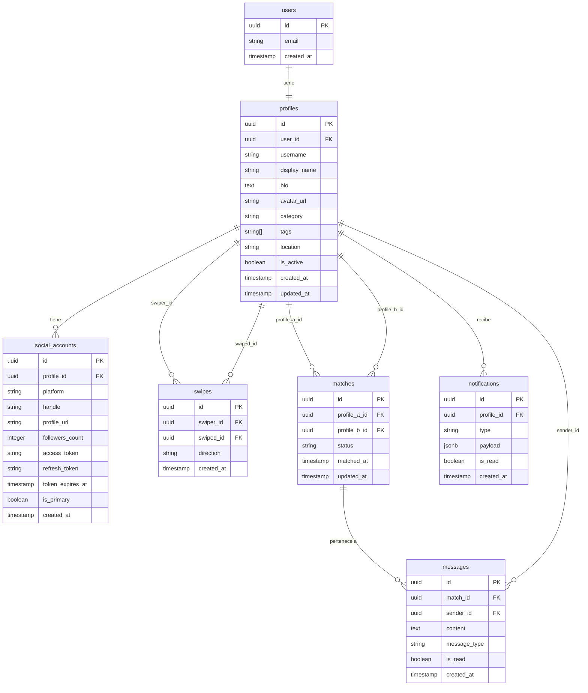

# Conetza — Diagrama de Base de Datos (ERD)

## Descripción de tablas

### `users`
Tabla nativa de Supabase Auth. Se extiende con `profiles`.

### `profiles`
Perfil público del creador de contenido.
- `category`: gaming, lifestyle, tech, fitness, music, etc.
- `tags`: arreglo de etiquetas del nicho (e.g. ["fps", "español", "tutorial"])

### `social_accounts`
Redes sociales vinculadas al perfil.
- `platform`: `twitch` | `instagram` | `tiktok` | `youtube` | `twitter`
- `is_primary`: la red con la que inició sesión (OAuth principal)

### `swipes`
Registro de cada swipe.
- `direction`: `like` | `pass`
- Índice único en `(swiper_id, swiped_id)` para evitar duplicados

### `matches`
Se crea cuando dos perfiles se dan like mutuamente.
- `status`: `active` | `unmatched`
- Índice único en `(profile_a_id, profile_b_id)` donde `profile_a_id < profile_b_id`

### `messages`
Mensajes dentro de un match.
- `message_type`: `text` | `image` | `link`

### `notifications`
Notificaciones in-app.
- `type`: `new_match` | `new_message` | `new_like`
- `payload`: datos extra en JSON (e.g. `{ "match_id": "...", "from": "username" }`)
